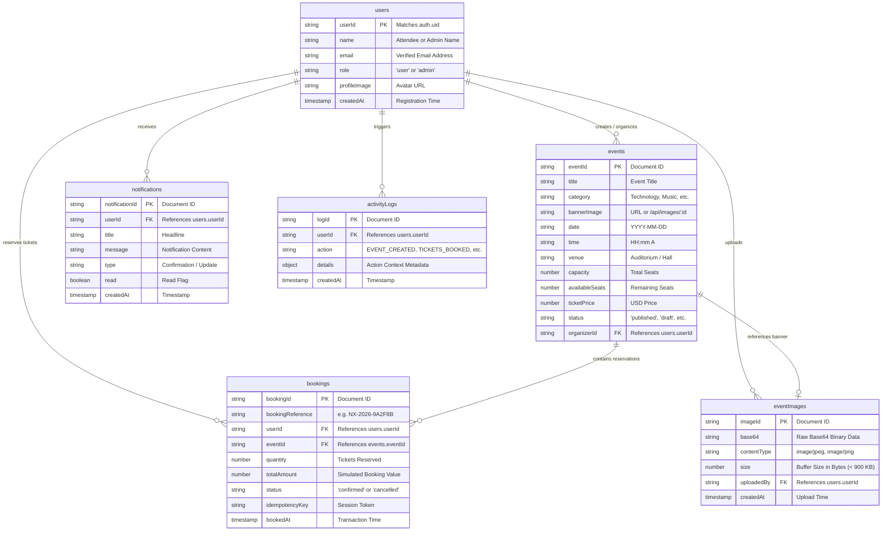

# NEXORA Database Schema Specification

This document provides the authoritative Cloud Firestore database architecture, entity models, field definitions, data types, relationships, indexes, storage pipelines, and security constraints for **NEXORA — Event Booking System**.

---

## 1. Architecture & Storage Overview

NEXORA utilizes Cloud Firestore as its primary document datastore, supported by the server-side Firebase Admin SDK for atomic transactions and administrative authorization.

### Data Storage Engines:
1. **Cloud Firestore Collections**: Primary persistent storage for user profiles, event specifications, ticket reservations, in-app notifications, audit logs, and image assets.
2. **Dual-Strategy Image Pipeline**:
   - **Firebase Cloud Storage**: Used when Google Cloud Storage buckets are provisioned (`events/{timestamp}_{filename}`).
   - **Firestore `eventImages` Fallback Collection**: High-reliability internal storage engine (`eventImages/{imageId}`) that stores client-compressed base64 images and streams them via `GET /api/images/:id` with immutable browser caching.

---

## 2. Firestore Collections Overview

NEXORA organizes data across six structured Firestore collections:

| Collection Name | Document Path | Primary Purpose | Write Authority |
|---|---|---|---|
| `users` | `users/{userId}` | User authentication profiles and RBAC role assignment | Client (`role: 'user'` on registration) & Admin SDK |
| `events` | `events/{eventId}` | Event specifications, schedules, locations, capacity, and seat inventory | Admin SDK / Verified Admin API |
| `bookings` | `bookings/{bookingId}` | Atomic ticket reservations, attendee info, and booking statuses | Express Backend Admin SDK Transaction only |
| `notifications` | `notifications/{notificationId}` | User confirmation alerts, schedule changes, and system notifications | Admin SDK (created during transactions) & User (mark read) |
| `activityLogs` | `activityLogs/{logId}` | Immutable audit trail for system actions, bookings, and cancellations | Admin SDK only |
| `eventImages` | `eventImages/{imageId}` | High-reliability persistent store for event banners (< 900 KB) | Admin SDK (`POST /api/upload`) |

---

## 3. Detailed Collection Schemas

### 1. `users` Collection
- **Path**: `users/{userId}`
- **Description**: Stores user profile information and system role (`user` or `admin`). The document ID matches the Firebase Authentication UID (`auth.uid`).

| Field | Type | Description | Required | Immutable by Client |
|---|---|---|---|:---:|
| `userId` | `string` | Unique identifier matching Firebase Auth UID | Yes | Yes |
| `name` | `string` | Full name of the user / attendee | Yes | No |
| `email` | `string` | User's verified email address | Yes | Yes |
| `role` | `string` | Access role: `'user'` \| `'admin'` | Yes | **YES (STRICT)** |
| `profileImage` | `string` (URL) | Avatar image URL (DiceBear avatar or Google photo URL) | No | No |
| `createdAt` | `string` (ISO 8601) | Account creation timestamp | Yes | Yes |
| `updatedAt` | `string` (ISO 8601) | Profile modification timestamp | Yes | No |

**Security Note**: Firestore Security Rules (`firestore.rules`) strictly enforce that client registration requests can only create documents with `role == 'user'`. Profile updates are prohibited from modifying the `role` field.

---

### 2. `events` Collection
- **Path**: `events/{eventId}`
- **Description**: Event catalog specifications, venue details, total capacity, remaining seats, ticket price, and publication status.

| Field | Type | Description | Required | Constraints |
|---|---|---|---|---|
| `eventId` | `string` | Auto-generated Firestore document ID | Yes | Unique |
| `title` | `string` | Official event title | Yes | Non-empty string |
| `slug` | `string` | URL-friendly slug generated from title | Yes | e.g. `tech-summit-2026` |
| `description` | `string` | Full markdown/text event description | Yes | Non-empty string |
| `category` | `string` | Category: `Technology` \| `Music` \| `Business` \| `Workshop` \| `Sports` \| `Education` \| `Art` \| `Conference` | Yes | Valid category |
| `bannerImage` | `string` (URL) | Image URL (`/api/images/:id` or external HTTPS URL) | Yes | No Base64 data URLs |
| `date` | `string` (YYYY-MM-DD) | Event calendar date | Yes | Valid date |
| `time` | `string` | Formatted display time (e.g. `09:00 AM - 05:00 PM`) | Yes | Display format |
| `startTime` | `string` | Scheduled start time (e.g. `09:00 AM`) | No | Time string |
| `endTime` | `string` | Scheduled end time (e.g. `05:00 PM`) | No | Time string |
| `venue` | `string` | Physical facility or auditorium name | Yes | e.g. `Silicon Hall` |
| `location` | `string` | Full address/location string | Yes | e.g. `Silicon Hall, Austin, TX` |
| `city` | `string` | City name | Yes | e.g. `Austin` |
| `organizerId` | `string` | UID of organizer/admin who created the event | Yes | References `users.userId` |
| `organizerName` | `string` | Display name of the organizer | Yes | Display format |
| `capacity` | `number` | Total venue seating capacity | Yes | Positive integer (> 0) |
| `availableSeats` | `number` | Remaining available unbooked seats | Yes | Decremented atomically |
| `ticketPrice` | `number` | Price per ticket in USD | Yes | Non-negative (>= 0) |
| `status` | `string` | Publication status: `'published'` \| `'draft'` \| `'cancelled'` \| `'completed'` | Yes | Default: `'published'` |
| `featured` | `boolean` | Flag to display event in landing page spotlight carousel | No | Default: `false` |
| `createdAt` | `string` (ISO 8601) | Document creation timestamp | Yes | Server timestamp |
| `updatedAt` | `string` (ISO 8601) | Last modification timestamp | Yes | Server timestamp |
| `createdBy` | `string` | Admin user UID who created the record | No | References `users.userId` |

---

### 3. `bookings` Collection
- **Path**: `bookings/{bookingId}`
- **Description**: Ticket reservation transactions created exclusively via atomic backend operations (`POST /api/bookings`).

| Field | Type | Description | Required | Notes |
|---|---|---|---|---|
| `bookingId` | `string` | Auto-generated Firestore document ID | Yes | Unique |
| `bookingReference` | `string` | Human-readable verification code (e.g. `NX-2026-9A2F8B`) | Yes | Unique reference |
| `userId` | `string` | UID of attendee who made the reservation | Yes | References `users.userId` |
| `userName` | `string` | Attendee full name at time of booking | Yes | Snapshot |
| `userEmail` | `string` | Attendee email address | Yes | Snapshot |
| `eventId` | `string` | Foreign key referencing `events.eventId` | Yes | Foreign Key |
| `eventTitle` | `string` | Event title snapshot | Yes | Denormalized snapshot |
| `eventCategory` | `string` | Event category snapshot | Yes | Denormalized snapshot |
| `eventBannerImage` | `string` | Event banner URL snapshot | Yes | Denormalized snapshot |
| `eventDate` | `string` | Event date snapshot | Yes | Denormalized snapshot |
| `eventTime` | `string` | Event time snapshot | Yes | Denormalized snapshot |
| `eventVenue` | `string` | Event venue name snapshot | Yes | Denormalized snapshot |
| `eventLocation` | `string` | Event location address snapshot | Yes | Denormalized snapshot |
| `quantity` | `number` | Number of tickets reserved | Yes | Positive integer (>= 1) |
| `ticketsBooked` | `number` | Alias for ticket quantity | Yes | Integer |
| `ticketPrice` | `number` | Price per ticket at time of purchase | Yes | USD |
| `totalAmount` | `number` | Simulated Booking Value (`quantity × ticketPrice`) | Yes | USD |
| `attendeeDetails` | `array` of `object` | Array of `{ name: string, email: string, phone?: string }` | Yes | List of pass holders |
| `status` | `string` | Status: `'confirmed'` \| `'cancelled'` | Yes | Default: `'confirmed'` |
| `idempotencyKey` | `string` | Unique client checkout token to prevent duplicate charges | No | Checked before write |
| `bookedAt` | `string` (ISO 8601) | Reservation completion timestamp | Yes | Timestamp |
| `updatedAt` | `string` (ISO 8601) | Last status update timestamp | Yes | Timestamp |

---

### 4. `notifications` Collection
- **Path**: `notifications/{notificationId}`
- **Description**: In-app notifications for attendees and administrators regarding booking confirmations, cancellations, and system updates.

| Field | Type | Description | Required | Notes |
|---|---|---|---|---|
| `notificationId` | `string` | Auto-generated Firestore document ID | Yes | Unique |
| `userId` | `string` | Recipient user UID | Yes | References `users.userId` |
| `title` | `string` | Notification headline (e.g. `Booking Confirmed!`) | Yes | String |
| `message` | `string` | Detailed message with reference code and event title | Yes | String |
| `type` | `string` | `'booking_confirmation'` \| `'event_update'` \| `'system'` | Yes | Type flag |
| `read` | `boolean` | Read/Unread status indicator | Yes | Default: `false` |
| `createdAt` | `string` (ISO 8601) | Notification creation timestamp | Yes | Timestamp |

---

### 5. `activityLogs` Collection
- **Path**: `activityLogs/{logId}`
- **Description**: Immutable platform audit trail for administrative tracking, compliance, and user activity analytics.

| Field | Type | Description | Required | Sample Values |
|---|---|---|---|---|
| `logId` | `string` | Auto-generated document ID | Yes | Unique |
| `userId` | `string` | User or Admin UID who performed the action | Yes | References `users.userId` |
| `action` | `string` | Event action type identifier | Yes | `EVENT_CREATED`, `EVENT_UPDATED`, `EVENT_DELETED`, `TICKETS_BOOKED`, `BOOKING_CANCELLED` |
| `details` | `object` | Structured metadata payload for audit context | Yes | `{ eventId, title, quantity, bookingReference }` |
| `createdAt` | `string` (ISO 8601) | Timestamp of activity execution | Yes | Server timestamp |

---

### 6. `eventImages` Collection (Cloud Image Storage Fallback)
- **Path**: `eventImages/{imageId}`
- **Description**: High-reliability internal image store for event banner uploads. Eliminates external storage bucket dependencies and Google Cloud billing requirements.

| Field | Type | Description | Required | Constraints |
|---|---|---|---|---|
| `base64` | `string` | Clean Base64 image payload (JPEG/PNG/WEBP) | Yes | Stripped of data URI header |
| `contentType` | `string` | Image MIME type (e.g. `image/jpeg`, `image/png`) | Yes | Valid image MIME type |
| `fileName` | `string` | Sanitized original filename | Yes | e.g. `banner_austin.jpg` |
| `size` | `number` | Decoded binary buffer length in bytes | Yes | Maximum 900 KB |
| `uploadedBy` | `string` | UID of administrator who uploaded the image | Yes | References `users.userId` |
| `createdAt` | `string` (ISO 8601) | Upload timestamp | Yes | Server timestamp |

**Streaming Delivery**: Images stored in `eventImages` are served publicly via `GET /api/images/:id`, which decodes the base64 string to a binary buffer and sets HTTP headers:
- `Content-Type: doc.contentType`
- `Cache-Control: public, max-age=31536000, immutable`
- `Content-Length: doc.size`

---

## 4. Entity Relationship Diagram (ERD)



---

## 5. Transaction Safety & Integrity Rules

### 1. Atomic Booking Transaction (`POST /api/bookings`)
To guarantee that no event can ever be overbooked regardless of concurrent requests:
1. `authMiddleware` verifies the attendee's Firebase ID Token.
2. Checks client `idempotencyKey` against existing bookings to prevent duplicate submissions.
3. Invokes `adminDb.runTransaction(async (transaction) => { ... })`:
   - Reads the event document: `transaction.get(eventRef)`.
   - Verifies `event.status === 'published'`.
   - Validates available seats: `if (event.availableSeats < quantity) throw new Error('INSUFFICIENT_SEATS')`.
   - Computes: `newAvailable = event.availableSeats - quantity`.
   - Updates event: `transaction.update(eventRef, { availableSeats: newAvailable })`.
   - Inserts booking: `transaction.set(bookingRef, bookingData)`.
   - Inserts in-app notification: `transaction.set(notificationRef, notificationData)`.
4. Appends audit entry in `activityLogs` (`TICKETS_BOOKED`).

### 2. Atomic Cancellation Transaction (`POST /api/bookings/:id/cancel`)
1. Verifies ownership (`booking.userId === req.user.uid || req.user.role === 'admin'`).
2. Verifies status is `'confirmed'`.
3. Invokes `adminDb.runTransaction()`:
   - Increments event seat inventory: `availableSeats = currentAvailable + booking.quantity`.
   - Updates booking status: `status = 'cancelled'`.
   - Dispatches cancellation confirmation notification to the attendee.
4. Appends audit entry in `activityLogs` (`BOOKING_CANCELLED`).

### 3. Event Capacity Reduction Safety (`PUT /api/events/:id`)
- Computes `ticketsBooked = capacity - availableSeats`.
- Rejects any edit that attempts to set `newCapacity < ticketsBooked` with `400 Bad Request`.
- Automatically recomputes `newAvailableSeats = newCapacity - ticketsBooked`.

### 4. Event Deletion Booking Guard (`DELETE /api/events/:id`)
- Queries active reservations for the event.
- If reservations exist, hard deletion is blocked to prevent orphaned bookings. Admins are instructed to update event status to `'cancelled'` or `'draft'`.

---

## 6. Firestore Security Rules Summary

The application security model enforces defense-in-depth across both Firestore Security Rules ([`firestore.rules`](file:///Users/merajuddin/Desktop/NEXORA/firestore.rules)) and Express backend middleware ([`auth.ts`](file:///Users/merajuddin/Desktop/NEXORA/server/src/middleware/auth.ts)):

```javascript
rules_version = '2';
service cloud.firestore {
  match /databases/{database}/documents {

    function isAuthenticated() {
      return request.auth != null;
    }
    function isOwner(userId) {
      return isAuthenticated() && request.auth.uid == userId;
    }
    function isAdmin() {
      return isAuthenticated() && 
        exists(/databases/$(database)/documents/users/$(request.auth.uid)) &&
        get(/databases/$(database)/documents/users/$(request.auth.uid)).data.role == 'admin';
    }

    // Users: Read own or admin; Create role: 'user' only; Prohibit role escalation
    match /users/{userId} {
      allow read: if isOwner(userId) || isAdmin();
      allow create: if isOwner(userId) && request.resource.data.role == 'user';
      allow update: if (isOwner(userId) && (!request.resource.data.diff(resource.data).affectedKeys().hasAny(['role']) || request.resource.data.role == resource.data.role)) || isAdmin();
      allow delete: if isAdmin();
    }

    // Events: Public read; Admin-only write
    match /events/{eventId} {
      allow read: if true;
      allow create, update, delete: if isAdmin();
    }

    // Bookings: Created strictly via Admin SDK transactions; Users read own
    match /bookings/{bookingId} {
      allow read: if isAuthenticated() && (resource.data.userId == request.auth.uid || isAdmin());
      allow create, update, delete: if isAdmin();
    }

    // Notifications: Read own; Toggle 'read' flag only
    match /notifications/{notificationId} {
      allow read: if isAuthenticated() && (resource.data.userId == request.auth.uid || isAdmin());
      allow update: if isAuthenticated() && 
        resource.data.userId == request.auth.uid && 
        request.resource.data.diff(resource.data).affectedKeys().hasOnly(['read']);
      allow create, delete: if isAdmin();
    }

    // Activity Logs: Admin read/write only
    match /activityLogs/{logId} {
      allow read, write: if isAdmin();
    }
  }
}
```

---

## 7. Firestore Composite Indexes

To support efficient filtering and sorting, the following composite indexes are configured:

1. **`bookings`**:
   - `userId` (Ascending) + `bookedAt` (Descending) — For attendee pass history.
   - `eventId` (Ascending) + `bookedAt` (Descending) — For event reservation audits.
2. **`events`**:
   - `status` (Ascending) + `date` (Ascending) — For public event discovery.
   - `category` (Ascending) + `date` (Ascending) — For category-filtered searches.
3. **`activityLogs`**:
   - `createdAt` (Descending) — For admin audit trail timeline.
4. **`notifications`**:
   - `userId` (Ascending) + `createdAt` (Descending) — For chronological notification feeds.
